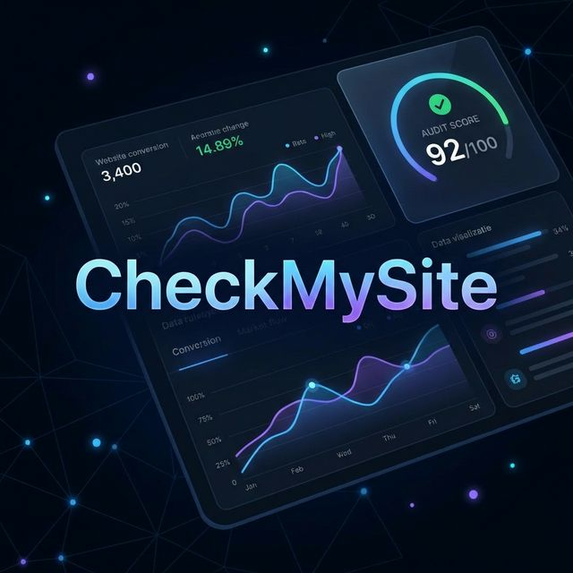
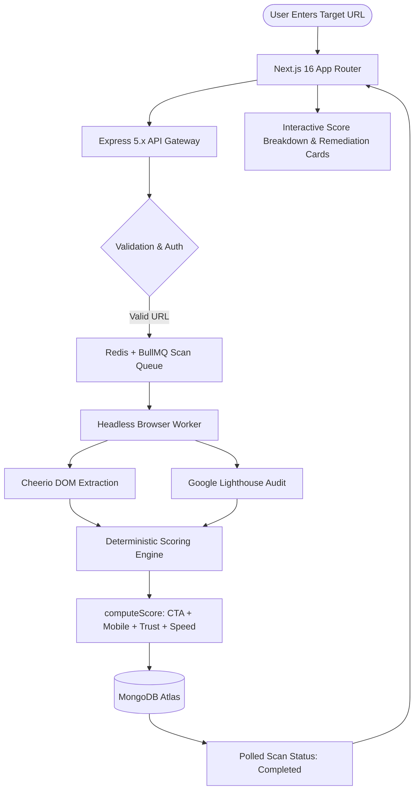

<div align="center">

# CheckMySite

**An automated, full-stack website conversion auditor that identifies design flaws, trust blockers, and UX friction using deterministic analysis.**

[](https://nextjs.org/)
[](https://react.dev/)
[](https://nodejs.org/)
[](https://expressjs.com/)
[](https://www.mongodb.com/)
[](https://redis.io/)
[](https://developer.chrome.com/docs/lighthouse/)
[](https://tailwindcss.com/)
[](https://opensource.org/licenses/MIT)

<br />



</div>

---

## Overview

CheckMySite is an open-source web audit engine created to diagnose why visitors bounce before converting. Rather than relying on speculative estimates or stochastic summaries, the engine evaluates web pages against concrete, deterministic rules spanning mobile ergonomics, call-to-action visibility, page speed, and consumer trust indicators.

The architecture emphasizes three core design principles:

1. **Deterministic Conversion Scoring**: Every score (0–100) is mathematically calculated using measurable DOM heuristics, viewport declarations, and asset metrics without arbitrary rating variations.
2. **Decoupled Asynchronous Processing**: Audits are managed via Redis and BullMQ task queues, shielding the HTTP API from long-running browser analyses and worker timeouts.
3. **Actionable Remediation Over Raw Data**: Results are compiled into a prioritized checklist with code-level guidance, explaining both the root cause of each issue and its direct impact on conversions.

---

## Core Highlights

- ⚡ **Instant Conversion Audits** — Analyze any public URL to calculate a global conversion health score (0–100) within seconds.
- 🎯 **Four-Pillar Evaluation Engine** — Granular signal breakdown across:
  - **Call to Action (CTA)**: Button contrast, placement, visual hierarchy, and action verbs.
  - **Mobile Responsiveness**: Viewport configurations, element tap targets, and layout scaling.
  - **Page Load Speed**: Headless Chrome performance profiles and resource weight evaluations.
  - **Trust Signals**: Favicons, SSL status, image alt attributes, meta descriptions, and semantic structure.
- 🛠️ **Prioritized Fix Roadmaps** — Issues are ranked by conversion severity, pairing each finding with specific remediation advice.
- 🔄 **Resilient Background Worker Architecture** — Asynchronous task processing using Redis and BullMQ, paired with no-cache client polling.
- 💳 **Monetization & Tier Upgrades** — Integrated Razorpay checkout workflow for unlocking comprehensive full-site scans.
- 🎨 **Modern Reactive Interface** — Built on Next.js 16, React 19, Tailwind CSS v4, and Framer Motion spring timelines with dark-mode glassmorphism.

---

## Platform Showcase

| A Good Website | A Great Website |
|:---:|:---:|
|  |  |
| **Functional & Flashy**<br />Communicates what a company does, but suffers from low contrast and unclear conversion funnels. | **Simple, Purpose-Driven & Focused**<br />Applies deterministic design principles to trigger instant user action and build immediate trust. |

---

## Audit & Analysis Pipeline

CheckMySite separates incoming scan submissions from analysis workloads using background queue workers:



1. **Submission**: The user enters a target website URL in the Next.js frontend, initiating a validation check via Zod.
2. **Queueing**: The Express backend registers a pending audit record in MongoDB and pushes the job onto the Redis BullMQ queue.
3. **Execution**: A dedicated worker pulls the job, evaluates DOM signals using Cheerio, and runs performance audits via Google Lighthouse and Chrome Launcher.
4. **Scoring**: Heuristic scores are synthesized across CTA, mobile, speed, and trust rules to compute the final conversion score and issues list.
5. **Presentation**: The frontend polls the API endpoint until completion, transitioning to an animated score circle and prioritized remediation list.

---

## Directory Structure

```text
checkmysite/
├── backend/                       # Node.js & Express 5 API
│   ├── analyzers/                 # DOM parsing & inspection logic (Cheerio & Puppeteer)
│   ├── config/                    # Database (Mongoose) & Redis connection configs
│   ├── jobHandler/                # Scan job lifecycle & dispatch helpers
│   ├── middleware/                # JWT authentication middleware
│   ├── model/                     # MongoDB models (Scan, User, Order)
│   ├── razorpayconfig/            # Razorpay client & checkout setup
│   ├── route/                     # Express route handlers (scan, user, order)
│   ├── scoring/                   # Deterministic scoring algorithms (CTA, Trust, Mobile)
│   ├── workers/                   # BullMQ background worker definitions
│   └── server.js                  # Backend server entry point
│
├── frontend/                      # Next.js 16 App Router Client
│   ├── app/                       # Page routes (landing, pricing, settings, payments)
│   ├── components/                # Reusable UI elements (WhyUsSection, WarmupLoader)
│   ├── config/                    # Frontend API integration & Axios instances
│   ├── context/                   # Global React state providers
│   ├── lib/                       # Utility functions & class name mergers
│   ├── public/                    # Static assets & platform comparison graphics
│   └── tailwind.config.js         # Tailwind CSS design system configuration
│
├── docs/                          # Documentation assets & platform screenshots
│   └── assets/                    # Showcase graphics and comparison visuals
└── README.md                      # Repository documentation
```

---

## Quick Start Guide

### Prerequisites
- **Node.js**: v18.0.0 or later
- **npm**: v9.0.0 or later
- **MongoDB**: Local MongoDB or MongoDB Atlas
- **Redis**: Local Redis instance or cloud Redis service (e.g., Upstash)

---

### 1. Repository Setup

```bash
git clone https://github.com/PRAVESH-110/checkmysite.git
cd checkmysite
```

---

### 2. Backend Setup

Navigate to the `backend` directory and install dependencies:

```bash
cd backend
npm install
```

Create a `.env` file in the `backend/` directory:

```env
PORT=5000
MONGODB_URI=your_mongodb_connection_string
JWT_SECRET=your_jwt_secret_key
FRONTEND_URL=http://localhost:3000

# Redis Configuration (BullMQ)
REDIS_HOST=127.0.0.1
REDIS_PORT=6379

# Payments (Razorpay)
RAZORPAY_KEY_ID=your_razorpay_key_id
RAZORPAY_KEY_SECRET=your_razorpay_key_secret
```

Start the backend server and queue worker:

```bash
npm run dev
```

The API will listen at `http://localhost:5000`.

---

### 3. Frontend Setup

In a separate terminal, navigate to the `frontend` directory and install dependencies:

```bash
cd frontend
npm install
```

Create a `.env` file in the `frontend/` directory:

```env
NEXT_PUBLIC_API_URL=http://localhost:5000/api/v1
```

Start the Next.js development server:

```bash
npm run dev
```

Open `http://localhost:3000` in your browser.

---

## Key API Endpoints

### Audits & Scans
- `POST /api/v1/scan` — Initiate an asynchronous audit for a website URL *(Authenticated)*
- `GET  /api/v1/scan/:scanId` — Fetch audit status, scores, signals, and prioritized issues

### User & Authentication
- `POST /api/v1/user/signup` — Register a new account
- `POST /api/v1/user/signin` — Authenticate and receive a JWT token
- `GET  /api/v1/user/me` — Retrieve the current user's profile and scan history

### Payments & Orders
- `POST /api/v1/create-order` — Initialize a Razorpay payment order for plan upgrades
- `POST /api/v1/verify-payment` — Validate payment signature and update account tier

---

## Contributing

Contributions are welcome! To contribute:

1. Fork the repository.
2. Create a feature branch: `git checkout -b feature/your-feature-name`.
3. Commit your changes: `git commit -m "feat: your feature summary"`.
4. Push to your branch: `git push origin feature/your-feature-name`.
5. Open a Pull Request detailing your changes.

---

## License

This project is licensed under the [MIT License](https://opensource.org/licenses/MIT).
